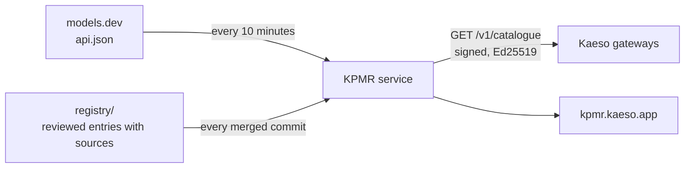

<div align="center">
  <br>
  <a href="https://kpmr.kaeso.app#gh-light-mode-only"></a>
  <a href="https://kpmr.kaeso.app#gh-dark-mode-only"></a>
  <br>
  <br>
  <p><b>The Kaeso Provider &amp; Model Registry.</b><br>models.dev, checked, corrected and extended for Kaeso, with a source for every change,<br>served to every Kaeso gateway as a signed catalogue in Kaeso's own format.</p>
  <p>
    <a href="https://kpmr.kaeso.app"><b>Registry</b></a> ·
    <a href="https://kpmr.kaeso.app/format"><b>Catalogue format</b></a> ·
    <a href="registry/README.md"><b>Add an entry</b></a> ·
    <a href="https://docs.kaeso.app"><b>Kaeso documentation</b></a> ·
    <a href="https://kaeso.app"><b>Kaeso</b></a>
  </p>
  <br>
</div>

## How it works



1. **models.dev stays the base.** Every 10 minutes the service fetches [models.dev](https://models.dev) (conditionally, with its ETag) and takes every provider and model from it.
2. **The registry wins where it speaks.** Each file in [`registry/providers`](registry/providers) corrects fields, adds models or providers models.dev doesn't have, removes wrong entries, and carries the facts only a gateway needs (adaptive thinking, effort levels, forced tool choice, the API a model is sent through). Every entry cites its sources. [`registry/index.toml`](registry/index.toml) holds the providers Kaeso calls and pricing rules, such as Anthropic's one-hour cache write price.
3. **Kaeso gets its own format.** A gateway asks for `GET /v1/catalogue?providers=…` in `application/vnd.kaeso.kpmr+json; version=1`, gets only the providers it calls, verifies the Ed25519 signature in `KPMR-Signature` and asks again when `refresh_seconds` says so; an unchanged catalogue costs a `304`. Prices are exact decimal strings, unknown values are `null`, and `corrected` lists every field KPMR changed. The [format page](https://kpmr.kaeso.app/format) is the reference.

## Run locally

Node.js 24 and pnpm 11 (`corepack enable`):

```sh
pnpm install
pnpm build
pnpm dev
```

`pnpm dev` serves the registry on http://localhost:8787 with its data in `.data/`, signed with a key made for the run. `pnpm dev:web` runs the interface with hot reload against it.

## Configuration

| Variable                | Default                       | Meaning                                                                                                                                 |
| ----------------------- | ----------------------------- | --------------------------------------------------------------------------------------------------------------------------------------- |
| `PORT`                  | `8080`                        | The HTTP port                                                                                                                           |
| `KPMR_DATA`             | `/data`                       | The last models.dev copy, the published catalogue, its state and the changes                                                            |
| `KPMR_POLL`             | `10m`                         | How often models.dev is asked; at least `1m`                                                                                            |
| `KPMR_MODELS_DEV_URL`   | `https://models.dev/api.json` | Where models.dev is fetched from                                                                                                        |
| `KPMR_PUBLIC_URL`       | `https://kpmr.kaeso.app`      | The public origin for canonical addresses, the sitemap and social previews                                                              |
| `KPMR_REVISION`         | `dev`                         | The registry's commit, set by the image build                                                                                           |
| `KPMR_SIGNING_KEY_FILE` | none                          | The Ed25519 private key (PEM) catalogues are signed with; `KPMR_SIGNING_KEY` holds it inline. Without either, a key is made for the run |
| `KPMR_SIGNING_KEY_ID`   | `kpmr-2026-10`                | The key's id, sent in `KPMR-Signature` and listed in `/v1/keys.json`                                                                    |

## Endpoints

| Path                                     | Answers                                                                                        |
| ---------------------------------------- | ---------------------------------------------------------------------------------------------- |
| `GET /v1/catalogue`                      | The signed catalogue; `?providers=a,b` for some providers; `406` for a format it doesn't serve |
| `GET /v1/meta.json`                      | Revision, sources, counts and registry notes                                                   |
| `GET /v1/providers.json`                 | Every provider with its counts                                                                 |
| `GET /v1/providers/<provider>.json`      | One provider and its models                                                                    |
| `GET /v1/models/<provider>/<model>.json` | One model: the catalogue entry, the models.dev original and the registry entry                 |
| `GET /v1/changes.json`                   | Changes, newest first (`?limit=`, `?provider=`)                                                |
| `GET /v1/keys.json`                      | The public keys catalogues are signed with                                                     |
| `GET /healthz`                           | `{ "status": "ok", "ready": … }`                                                               |

Every other address is the registry's interface, in English, German (`/de`) and Simplified Chinese (`/zh-CN`).

## License

[MIT](LICENSE). The catalogue derives from [models.dev](https://models.dev) (MIT); see [NOTICE.md](NOTICE.md). The Kaeso name and logo are not covered by the license.
